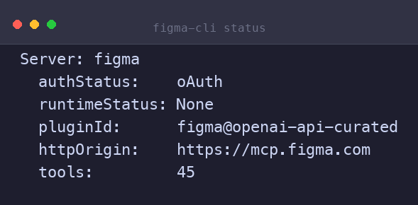

<div align="center">

# pi-figma-bridge

### 让 Codex CLI 自带的 Figma MCP 工具走出 TUI。

**`figma-cli` 直接驱动 `codex app-server` 的 JSON-RPC 接口，把 `figma@openai-api-curated` 暴露的 45 个 Figma 工具打包成一个能从 shell / CI / 其他进程里调用的独立命令。**

[](https://github.com/gztcode/pi-figma-bridge/releases/tag/v1.0.3)
[](LICENSE)
[](https://www.python.org/)
[](#安装)
[](.github/workflows/ci.yml)

[安装](#安装) · [用法](#用法) · [工具清单](#工具清单) · [工作原理](#工作原理) · [环境变量](#环境变量) · [故障排查](#故障排查) · [为什么存在](#为什么存在) · [更新](#更新)

<p align="center">
  
</p>

</div>

> **这是什么**：Codex CLI 已经内置了 `figma@openai-api-curated` 这个 Figma MCP 插件（在 Codex TUI / Desktop 里能用），但 `codex exec` 和非 Codex 上下文拿不到这些工具。本项目直接驱动 `codex app-server`（Codex 内置的 JSON-RPC 守护进程），把 45 个 Figma 工具暴露成一个独立的 `figma-cli` 命令 —— 不开 Codex TUI，单调用 1-3s 启动，可塞进 CI / cron / shell 脚本。

> **关于命名**：仓库叫 `pi-figma-bridge`，里面的 `pi-` 指 [Pi Coding Agent](https://github.com/badlogic/pi-coding-agent)（写这个工具的 AI agent），**不是** Codex 或 Figma 的项目符号 —— 工具本身完全跑在 Codex CLI 上，和 Pi 没有运行时依赖。装好后实际敲的命令是 `figma-cli`，跟仓库名差了一截是历史原因，不打算改了。

## 安装

**前置条件**

- macOS 或 Linux
- Python 3.9+（纯标准库，无第三方依赖）
- 已安装并登录 [Codex CLI](https://github.com/openai/codex)（`codex --version` 应 ≥ 0.160）
- Codex CLI 已启用 `figma@openai-api-curated` 插件（默认开启）
- Figma OAuth 已通过 Codex 完成（首次执行会自动弹浏览器）

**一键安装**

```bash
curl -sL https://raw.githubusercontent.com/gztcode/pi-figma-bridge/main/install.sh | bash
```

或者手动：

```bash
git clone https://github.com/gztcode/pi-figma-bridge.git
cd pi-figma-bridge
chmod +x figma-cli
ln -s "$(pwd)/figma-cli" ~/.local/bin/figma-cli   # 或复制到任何 $PATH 目录
```

**验证连接**

```bash
figma-cli status
# Server: figma
#   authStatus:    oAuth
#   runtimeStatus: None
#   pluginId:      figma@openai-api-curated
#   httpOrigin:    https://mcp.figma.com
#   tools:         45
```

看到 `tools: 45` 且 `authStatus: oAuth` 就说明通了。首次启动约 15s（远程 OAuth + 异步加载工具列表），后续调用 1-3s。

## 用法

```bash
figma-cli status                                  # 查 server 状态 / 认证
figma-cli tools                                   # 列出全部 45 工具
figma-cli schema <tool>                           # 查 inputSchema（JSON）
figma-cli call <tool> '<json-args>'               # 调工具（JSON 模式）
figma-cli call <tool> [k=v ...]                   # 调工具（k=v 简化模式）
```

### 两种参数写法

```bash
# JSON 模式（适合复杂 / 多行 / number / bool / object）
figma-cli call create_new_file '{"fileName":"My Design","editorType":"design","planKey":"team::YOUR_PLAN_KEY"}'

# k=v 简化模式（值会当 string 传；number / bool / object 用 JSON 模式）
figma-cli call create_new_file fileName=MyDesign editorType=design planKey=team::YOUR_PLAN_KEY
```

### 典型工作流

**1. 拿自己的 Figma 身份**

```bash
figma-cli call whoami '{}'
# { handle, email, plan_key, ... }
```

**2. 建一个新文件**

```bash
figma-cli call create_new_file fileName="My Design" editorType=design planKey=$(figma-cli call whoami '{}' | jq -r .plan_key)
# { file_key, file_url, message }
```

**3. 跑 Plugin API 写设计**（需先读 Figma Plugin API 文档）

`use_figma` 接收一段 JavaScript，在 Figma Plugin API 环境跑：

```bash
figma-cli call use_figma "$(jq -n --arg code "$(cat /tmp/code.js)" \
  '{fileKey:"FILE_KEY",code:$code,description:"Create a login card"}')"
```

**5. 截图已有节点**

```bash
figma-cli call get_screenshot '{"fileKey":"FILE_KEY","nodeId":"1:2","maxDimension":1024}'
# { image_url, width, height }
```

> `maxDimension` 之类需要 number 的字段必须用 JSON 模式（k=v 会当 string，Figma 会拒）。

仓库自带 `examples/`：

```bash
examples/get-screenshot.sh        # 抓 Figma 节点截图，自动下载 PNG
examples/whoami-and-create.sh    # 查身份 + 建一个新文件
```

## 工具清单

`figma-cli tools` 列出全部 45 个工具。几个高价值的：

| 工具 | 用途 |
| --- | --- |
| `whoami` | 查 Figma 身份 / plan / OAuth 状态 |
| `create_new_file` | 建新 Figma 文件 |
| `use_figma` | **万能**：传 JS 在 Figma Plugin API 里跑（创建 / 编辑 / 查节点） |
| `get_screenshot` | 截节点渲染图（返回 short-lived URL） |
| `get_design_context` | 读节点的设计上下文（结构、变量、样式） |
| `generate_diagram` | AI 生流程图 / 架构图 / 时序图 |
| `generate_image` | AI 生图片 |
| `html_to_figma` | HTML → Figma 节点（像素级） |
| `generate_figma_design` | 抓活网页到 Figma |
| `download_assets` / `upload_assets` | 资产下载 / 上传 |

## 工作原理

1. **启动** `codex app-server`（stdio transport，Codex 自带的 JSON-RPC 守护进程）
2. **握手** `initialize` (v1) → `notifications/initialized`（v1 → v2 协议切换点）
3. **轮询** `mcpServerStatus/list` 直到 figma server 出现且 tools 加载完（首次 ~15s，因为 figma 走远程 OAuth + 异步加载 45 个工具）
4. **启动 thread** `thread/start { cwd, approvalPolicy: "never", sandbox: "read-only" }` 拿 `threadId`
5. **调工具** `mcpServer/tool/call { server: "figma", tool, arguments, threadId }`
6. **退出** stdin EOF → SIGTERM → wait

```json
// 一次调用的 JSON-RPC 序列
{"jsonrpc":"2.0","id":1,"method":"initialize","params":{"clientInfo":{"name":"figma-cli","version":"1.0.2"},"capabilities":{}}}
{"jsonrpc":"2.0","method":"notifications/initialized"}
{"jsonrpc":"2.0","id":2,"method":"thread/start","params":{"cwd":".","approvalPolicy":"never","sandbox":"read-only"}}
{"jsonrpc":"2.0","id":3,"method":"mcpServer/tool/call","params":{"server":"figma","tool":"whoami","arguments":{},"threadId":"<thread-id>"}}
```

完整 schema 用 `figma-cli schema <tool>` 看。

## 故障排查

**`codex` 不在 PATH**

```text
错误: 'codex' 不在 PATH
```

装 Codex CLI：`brew install --cask codex`（或见 [openai/codex](https://github.com/openai/codex)）。

**`initialize 失败`**

Codex 没装好或版本不兼容。试 `codex --version` 确认 `0.160+`。

**`figma MCP server 不在 status 列表里`**

- 确认 `~/.codex/config.toml` 的 `[plugins]` 里有 `figma@openai-api-curated`
- `codex mcp list` 应该有 figma 行 enabled + OAuth
- 没登录：`codex mcp login figma`（会弹浏览器走 Figma OAuth）

**OAuth metadata discovery 失败**

间歇性，重试一次。

**timeout after 180s**

大 `use_figma` 脚本（30+ 节点）可能需要更久：`FIGMA_CLI_TIMEOUT=300 figma-cli call ...`。

## 环境变量

| 变量 | 默认 | 用途 |
| --- | --- | --- |
| `FIGMA_CLI_VERBOSE=1` | off | 打印 JSON-RPC 调试输出 + codex stderr |
| `FIGMA_CLI_TIMEOUT=N` | 180 | 工具调用超时（秒），复杂 `use_figma` / `create_new_file` 需 120-180s |

## 更新

重新跑安装脚本即可（会拉最新 release）：

```bash
curl -sL https://raw.githubusercontent.com/gztcode/pi-figma-bridge/main/install.sh | bash
```

或装指定版本：

```bash
./install.sh v1.0.3
```

## Changelog

**v1.0.3**

- README hero 加一张 `figma-cli status` 终端截图，源码走 `scripts/render_terminal.py`（PIL，标准库外唯一依赖）；未来换图直接改脚本 + 重新出 PNG 即可
- CI 改成 4 路矩阵：`macOS-latest × 系统 Python` + `ubuntu-latest × py3.9/3.11/3.13`；shellcheck 在 macOS 用 brew，ubuntu 用 apt；所有 action pin 到 commit SHA（`actions/checkout@11bd71901bbe...`）和`actions/setup-python@5fda3b95...`），不是 tag
- 加 `release.yml`：tag push `v*` 触发，校验 tag 格式，用 `softprops/action-gh-release@v2`（SHA `3bb12739c298...`）自动写 release body，从前的 `go` 三连手动出报表
- 版本号同步：`figma-cli` `clientInfo.version`、`install.sh` 注释、README badge / install 示例全部跳到 `1.0.3`

**v1.0.2**

- 文档：在「这是什么」callout 下方加「关于命名」callout，说清楚 `pi-` 前缀的含义和「repo 名 ≠ 二进制名」这个一致关系
- 版本号：`figma-cli` 的 `clientInfo.version`、`install.sh` 注释、README badge / 协议示例 / install 命令全部同步到 `1.0.2`

**v1.0.1**

- ci：替换已弃用的 `ludeeus/action-shellcheck`，直接在 runner 上装并跑 shellcheck
- 文档：README 重构，对齐现代 README 风格

**v1.0.0**

- 初版：4 个子命令（`status` / `tools` / `schema` / `call`），45 个 Figma MCP 工具透传

## 为什么存在

Codex CLI 的 `figma@openai-api-curated` 插件在 `codex exec` 模式下 **不会** 把 MCP 工具注入到 session（实测：只有 Codex TUI / Desktop / app-server 路径能拿到这些工具）。这个 CLI 直接驱动 `codex app-server` 的 JSON-RPC 接口，让非 Codex 上下文也能用 Figma MCP。

另一个场景是自动化流水线。`codex exec` 跑一次要 5-30s 启动模型，这个 CLI 只 spawn daemon + 发 JSON-RPC，单调用 1-3s。

---

这个项目本身是 [Pi Coding Agent](https://github.com/badlogic/pi-coding-agent) 通过 Figma Plugin API 画了第一张测试卡片后，自己封装发布出来的 —— 一个完整的「AI agent 写一个工具」的端到端示例。

## License

MIT